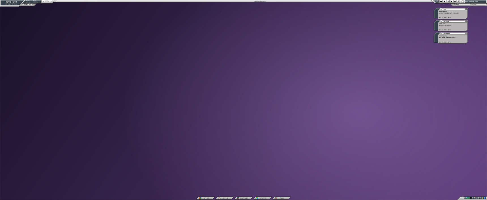
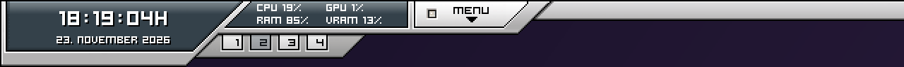
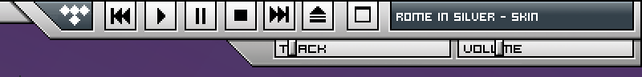
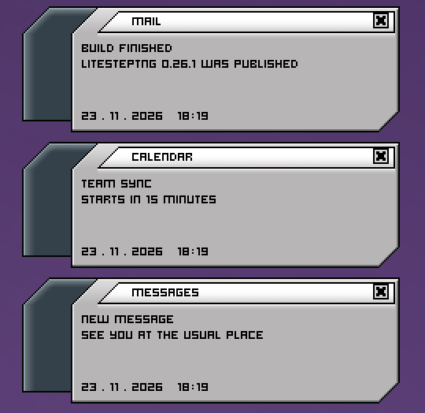
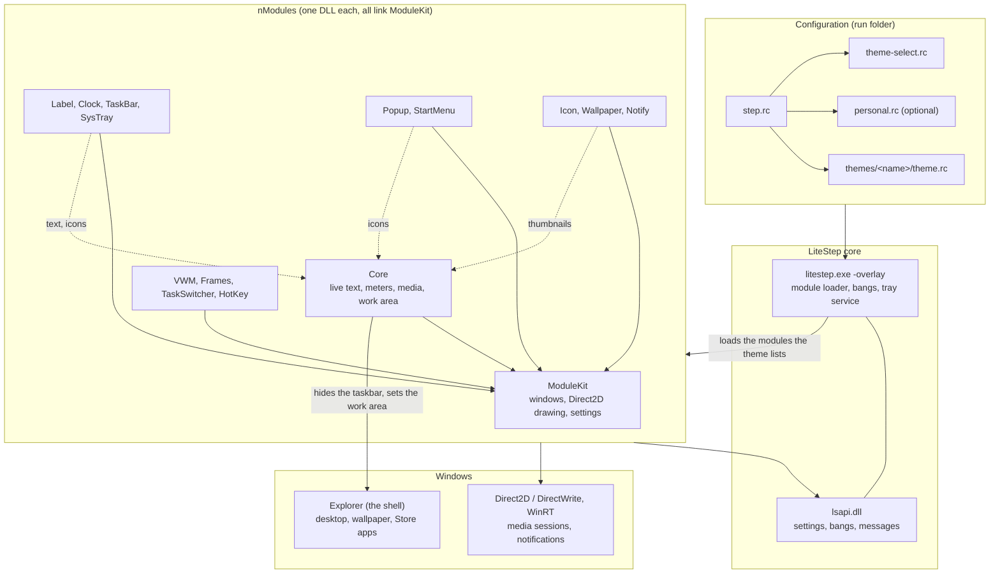

# LiteStep TNG

A modern x64 build of the classic **LiteStep** desktop for Windows 10 and 11, with
Direct2D rendering and the nModules suite. It runs **on top of Explorer**: Explorer stays
the Windows shell, so Store apps, Settings and everything else that depends on it keep
working, while LiteStep replaces what you see — bars, menus, task list, tray, virtual
desktops, notifications and desktop icons — with a theme.



The default theme, **LiteStep Enhanced**, is a port of Norman Kaczmarek's 2002 theme of
the same name.

| | |
|---|---|
| Clock, system meters, virtual desktops and the menu button |  |
| Media player controls, now playing, track and volume sliders |  |
| Program categories |  |
| Windows notifications as boxes on the desktop |  |

## Install

Download the latest release from the [releases page](../../releases/latest):

- **`LiteStepTNG-<version>-x64-setup.exe`** — the installer. It installs for the current
  user (no administrator rights), into `%LOCALAPPDATA%\Programs\LiteStepTNG`, and can
  start LiteStep when you sign in. It does not change the Windows shell.
- **`LiteStepTNG-<version>-x64.zip`** — the same files, to unpack anywhere you can write
  to. Start it with `litestep.exe -overlay`.

Requirements: Windows 10 version 2004 or newer, or Windows 11, 64-bit.

The LiteStep Enhanced theme is designed for the pixel font **hooge 05_55**, which is not
included. Without it Windows substitutes another font and the text looks different.

To leave LiteStep, run `litestep.exe !Quit` (or uninstall it); Explorer's taskbar comes
back. If LiteStep is killed instead, the taskbar stays hidden until LiteStep or Explorer
is started again.

## What is in it

- **Themes:** LiteStep Enhanced (default), Glass and Prototype-X. Change the theme from
  the menu, or by editing `ThemeName` in `theme-select.rc`.
- **Bars and labels** (`nLabel`, `Clock`): clock, date, live text such as `[CPU]`,
  `[GPU]`, `[Memory]`, `[VRAM]` and `[NowPlaying]`, sliders for volume and track position.
- **Task list and tray** (`nTaskbar`, `nTray`). Explorer's own taskbar is hidden while
  LiteStep runs (`HideExplorerTaskbar false` in a theme keeps it).
- **Popup menus** (`nPopup`, `StartMenu`): programs, folders, favourites, recent
  documents, themes.
- **Media control:** buttons that drive the player you choose (the rotation is configured
  in the theme) through the Windows media session.
- **Virtual desktops** (`VWM`): four desktops with a transition; right-click a desktop
  button, or press Win+Shift+1..4, to send the active window there.
- **Notifications** (`Notify`): Windows toasts shown as theme boxes; click one to go to
  its program, or close it with the X.
- **Desktop icons** (`Icon`): the Desktop folder drawn in the theme's style, with
  thumbnails and drag and drop.
- **Window frames** (`Frames`, experimental): a themed frame around other programs'
  windows that have a standard title bar.
- **Wallpaper:** a theme may bring its own (`ThemeWallpaper`); otherwise the wallpaper you
  choose in Windows is used.

### Personal settings

Things that belong to you live next to `litestep.exe` and are never overwritten by an
update:

- `personal.rc` — settings that override the theme (see `personal.rc.example`).
- `theme-select.rc` — the selected theme.
- `favorites\` and `games\` — shortcuts shown in the menu.

## Architecture



Explorer remains the shell and keeps drawing the desktop and the wallpaper. `litestep.exe`
reads the configuration, loads the modules the theme asks for, and each module draws its
own windows on top.

## Build from source

You need Visual Studio 2022 (or its Build Tools) with the v143 toolset and a Windows 10
SDK.

```powershell
git clone <repository-url>
cd LitestepTNG
msbuild litestep.sln /p:Configuration=Release /p:Platform=x64 /m
```

Binaries land in `bin\Release_x64\`. LiteStep runs from a separate folder (the "run
folder"), not from the repository; the scripts in `tools\` take care of that:

```powershell
.\tools\deploy.ps1 -LiteStepDir <run folder>      # copy the build and the themes, restart
.\tools\smoke-test.ps1 -LiteStepDir <run folder>  # drive the running shell and check it
.\tools\package.ps1 -Version 1.2.3                # zip + installer (Inno Setup 6) in dist\
```

Always start LiteStep with `-overlay`. Without it, LiteStep sees Explorer's taskbar and
asks what to do.

Every push is built and packaged by GitHub Actions (`.github\workflows\build.yml`);
pushing a tag `v<version>` publishes a release.

`AGENTS.md` is the detailed guide to the code: architecture, how the modules work, theme
authoring, and the reasons behind the less obvious decisions.

## Repository layout

```
litestep\     the core executable (litestep.exe)
lsapi\        the LiteStep API (lsapi.dll, lsapi.h)
modules\      the nModules DLLs and their shared library, ModuleKit
themes\       one folder per theme, each with a theme.rc
tools\        deploy, smoke test, theme switch and packaging scripts
installer\    the Inno Setup script
step.rc       the loader: theme-select.rc, the optional personal.rc, then the theme
```

## Notes for theme and module authors

- Themes are `theme.rc` files for the nModules suite. Use `$LiteStepDir$`, `$ThemeName$`
  and `$USERNAME$` instead of literal paths.
- Do not load `Desk.dll` on top of Explorer: it takes over Explorer's desktop view. It is
  not included in the releases.
- Modules are built against `lsapi\lsapi.h` and link `ModuleKit`.
- The core also contains an experimental declarative engine ("Theme Engine V2",
  `litestep\themev2`, files `theme.lsx` / `theme.lsxstyle`). The themes shipped here do
  not use it.

## Credits and license

LiteStep TNG builds on the work of the LiteStep Development Team, the nModules project,
and the LiteStepTNG fork this repository comes from. The LiteStep Enhanced theme was
created by Norman Kaczmarek.

LiteStep is free software, released under the GNU General Public License, version 2 or
later. See [LICENSE](LICENSE).
